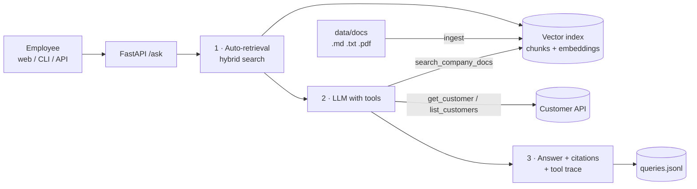

# Company Knowledge Assistant — RAG + Tool-calling Agent

An internal assistant for a (fictional) SaaS company, **Nimbus Flow**. Employees ask questions in plain language; the assistant answers from company documents with **source citations**, and uses an **agent with tools** to look up live customer data from a CRM API — including questions that need both ("Karimi Shop has a critical issue — what response time do they get on their plan?").

Runs fully locally with **Ollama** (no API costs, no data leaves the machine), or with any OpenAI-compatible provider.

## What it shows

| Skill | Where |
|---|---|
| Document ingestion and chunking by markdown structure, with overlap | `app/rag.py` |
| Embeddings + **hybrid search** (vector cosine + BM25 keyword) | `app/rag.py` |
| Grounded generation with citations `[S1]` mapped back to file and section | `app/agent.py` |
| **Tool-calling agent** loop with step budget and forced final answer | `app/agent.py` |
| Tools with argument validation, privacy filtering, retries | `app/tools.py` |
| Provider-agnostic LLM client with retries and tool-call normalization | `app/llm.py` |
| REST API, web chat UI, CLI, query logging, conversation memory | `app/api.py`, `web/`, `app/cli.py` |
| **Evaluation set** (20 questions) with retrieval and answer metrics | `eval/` |
| 43 automated tests with a deterministic fake LLM | `tests/` |

## Architecture



**Per question:**
1. **Automatic retrieval.** The question is always searched first and the top passages are given to the model as `[S1]…[Sn]`, so even a small model that skips tools answers from company data.
2. **Tool loop** (max 5 steps). The model can search again with a better query, look up one customer (by email, `cus_` id, or name/company), or list customers by plan/status. Tool errors are returned to the model as data so it can recover.
3. **Answer.** The model must cite document facts as `[S#]` and mark CRM facts `(CRM)`. Cited references are mapped back to file and section and returned with the tool trace and latency.

### Design decisions

- **Hybrid search.** Embeddings capture meaning ("money back" ≈ "refund"); BM25 catches exact tokens embeddings often miss (`P1`, `99.9`, `€149`, ticket ids). Score = `0.7·cosine + 0.3·normalized BM25`.
- **Structure-aware chunks.** Chunks follow headings and carry their path (`Plans > Business`), which improves retrieval and gives readable citations. Tiny sections are merged; long ones are split on sentence boundaries with overlap.
- **Retrieval first, tools second.** Small local models are unreliable at deciding *when* to call a search tool; always retrieving first removes that failure mode while keeping tools for follow-ups and live data.
- **Guardrails.** Answers only from retrieved data; "not found" instead of guessing; document text treated as data, not instructions (prompt-injection defence); phone numbers never sent to the model; tool arguments validated (`cus_` id pattern, email format, enum filters).
- **Honest failures.** LLM outages produce a friendly error with the trace, never a made-up answer. Index/model mismatch is detected and asks for re-ingest.

## Project layout

```
app/
  config.py     settings from env / .env
  llm.py        OpenAI-compatible client (chat + embeddings), retries, tool-call parsing
  rag.py        loading, chunking, BM25, vector index, hybrid search
  tools.py      search_company_docs, get_customer, list_customers + CRM client
  agent.py      retrieval + tool loop + citations
  service.py    wiring, sessions, query log
  api.py        FastAPI: /, /ask, /health, /ingest, /sessions/{id}
  cli.py        ingest | search | ask | chat
web/index.html  chat UI (sources and tool calls shown under each answer, RTL-aware)
data/docs/      6 company documents (pricing, refunds, SLA, security, onboarding, limits)
mock-crm/       customer API (from project 1) + seed.json with 5 customers
eval/           questions.json (20 cases) + run_eval.py
tests/          43 pytest tests (no LLM or network needed)
```

## Setup (Ubuntu / Linux)

**Requirements:** Docker, Ollama (already installed for project 1), about 3 GB of disk space for models.

```bash
# 1. models
ollama pull qwen2.5:3b          # chat model with tool calling
ollama pull nomic-embed-text    # embedding model (~270 MB)

# 2. start the assistant + customer API
cd company-rag-agent
docker compose up -d --build

# 3. build the document index
docker compose exec app python -m app.cli ingest

# 4. use it
xdg-open http://localhost:8000
```

Ollama must accept connections from Docker (`OLLAMA_HOST=0.0.0.0`, configured in project 1).

### Without Docker

```bash
python3 -m venv .venv && source .venv/bin/activate
pip install -r requirements.txt
cp .env.example .env
PORT=4001 node mock-crm/server.js &          # customer API
python -m app.cli ingest
uvicorn app.api:app --port 8000
```

## Usage

**Web:** http://localhost:8000 — example questions are on the start screen. Each answer shows source chips (`S1 · 03-support-and-sla.md § Priority levels`) and tool chips (`⚙ get_customer({"name_or_company":"Acme"})`).

**CLI:**
```bash
docker compose exec app python -m app.cli ask "Is Acme GmbH entitled to 24/7 phone support?"
docker compose exec app python -m app.cli search "refund annual plan"     # inspect retrieval only
docker compose exec -it app python -m app.cli chat
```

**API:**
```bash
curl -s localhost:8000/ask -H 'Content-Type: application/json' \
  -d '{"question":"Which customers are past due?"}' | jq
```
```json
{
  "session_id": "3f9c0a1b2c4d",
  "answer": "Weber Logistik AG (cus_1005) is past due; its last invoice INV-2026-0850 is overdue (CRM).",
  "sources": [],
  "tool_calls": [{"tool": "list_customers", "arguments": {"status": "past_due"}, "ok": true}],
  "steps": 2,
  "latency_ms": 4210,
  "error": null
}
```
Pass the returned `session_id` for follow-up questions.

**Add your own documents:** put `.md`, `.txt` or `.pdf` files into `data/docs/`, then run `ingest` again (or `POST /ingest`).

## Evaluation

```bash
docker compose exec app python eval/run_eval.py --retrieval-only   # seconds
docker compose exec app python eval/run_eval.py                    # full, a few minutes on CPU
```

Writes `eval/results.md` with:
- **Retrieval:** hit@1, hit@k and MRR — is the right document found?
- **End-to-end:** answer contains the expected fact, correct tool used, correct source cited, latency, and pass rate per type (docs / customer / combined / not-found).

Use it before and after changing the model, prompt, chunk size or `HYBRID_ALPHA`.

## Tests

```bash
docker compose exec app python -m pytest -q      # or locally: python -m pytest -q
```
Chunking, BM25, retrieval per document, index save/load, model mismatch, tool-call parsing (including JSON-in-content from small models), LLM retry rules, every tool against the real mock CRM (validation, not-found, ambiguous, CRM down), the agent loop (tool use, error recovery, step budget, LLM outage, memory limit) and the API.

## Configuration

All settings are environment variables (see `.env.example`): model names and endpoint, `CHUNK_SIZE`, `CHUNK_OVERLAP`, `TOP_K`, `MIN_SCORE`, `HYBRID_ALPHA`, `MAX_AGENT_STEPS`. To use OpenAI instead of Ollama: `LLM_BASE_URL=https://api.openai.com/v1`, `LLM_API_KEY=sk-…`, `CHAT_MODEL=gpt-4o-mini`, `EMBED_MODEL=text-embedding-3-small`, then re-ingest.

## Known limitations and next steps

- `nomic-embed-text` is English-focused, so questions in Persian retrieve worse. The agent can still search again in English; a multilingual embedding model such as `bge-m3` is the proper fix.
- Small local models (3B) are slower on CPU and sometimes skip citations; a 7B model or a hosted model improves answer quality.
- Next: n8n workflow that answers support emails through `/ask`; per-user access control on customer data; re-ranking with a cross-encoder; streaming answers.
